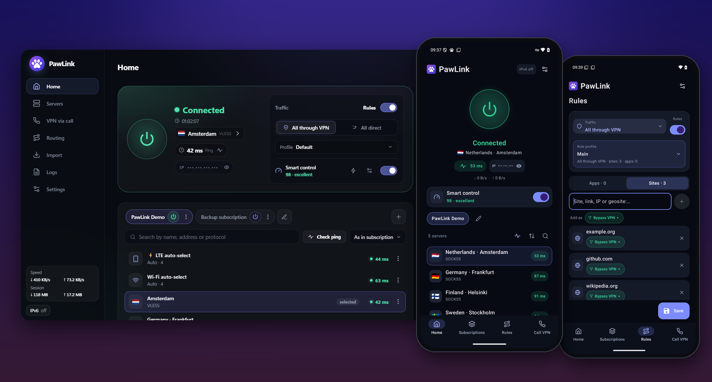
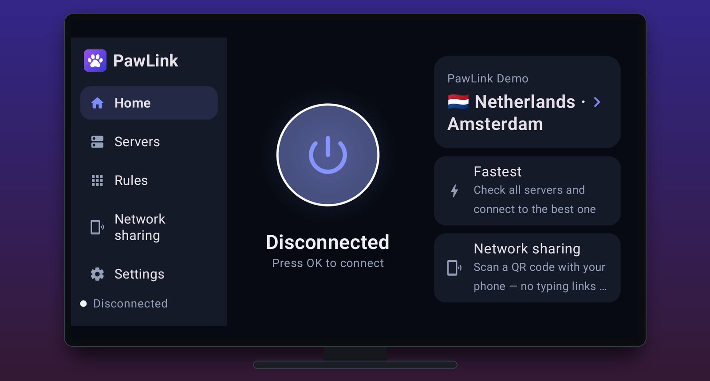

  <a href="README.md">Русский</a> · <strong>English</strong>

  

<h1 align="center">PawLink</h1>

  <strong>VPN client for Windows, Android, and Android TV</strong> 
  Add a subscription or access key and connect with one tap.

  
  
   
  One APK for Android and Android TV · <a href="../../releases">All releases</a>

  
   
  PawLink 3.0.0 interface · demo data

## Quick start

1. Download and install PawLink.
2. Add a subscription link or access key from your VPN provider. Open Import on Windows or tap “+” in Subscriptions on Android. On your phone, you can also scan a QR code or share a link to PawLink.
3. Choose a server and press the connect button.

PawLink is free. You can use a subscription or access key from your VPN provider, or connect to your own server.

## Features

- **Automatic server selection and reconnection.** PawLink checks server availability and can switch to another server if the current one fails.
- **Split tunneling.** Choose which websites and apps use the VPN and which connect directly. Save your rules in separate profiles.
- **VPN over a call.** A WDTT-Plus mode for restricted networks. Import a connection link or set up your own VPS. Availability depends on the network.
- **Ad blocking.** Turn it on in settings.

## Android TV

Install the same APK and enable TV mode. The large controls are designed for a remote. To transfer servers, open “Network sharing” on the TV. On your phone, select “Network sharing” → “Send,” then scan the TV’s QR code or enter its eight-digit code.

  

## FAQ

<strong>Which formats are supported?</strong>

Subscription links, individual access keys, QR codes, and Clash or WireGuard files. Supported protocols include VLESS (including REALITY), VMess, Trojan, Shadowsocks, Hysteria2, TUIC, WireGuard, AmneziaWG, SOCKS, and HTTP.

<strong>How do I install PawLink if the system shows a warning?</strong>

In Windows SmartScreen, select “More info” → “Run anyway.” TUN mode requires administrator privileges. On Android, allow app installs from the source you used to open the APK.

<strong>What should I check if the VPN disconnects in the background on Android?</strong>

Check battery restrictions for PawLink and the “Always-on VPN” setting in other VPN apps.

<strong>How do I exclude an app from the VPN?</strong>

Open Rules and select an app routing mode. Some Android apps can detect an active system VPN even when their traffic goes directly.

<strong>What do I need to host my own VPN over a call?</strong>

A VPS running Ubuntu 22.04 or 24.04, with at least one CPU core, 512 MB of RAM, and SSH access. PawLink can install the components and generate connection links.

## Feedback

Report a bug or suggest an improvement in [Issues](https://github.com/FelixEnotix/PawLink/issues). For bugs, include your platform, PawLink version, and steps to reproduce.

---

VPN over a call is based on <a href="https://github.com/Ivan4537/WDTT-Plus">WDTT-Plus</a> (GPLv3). Windows flags use Twemoji Country Flags (CC BY 4.0). <a href="LICENSE">Licenses</a>.
