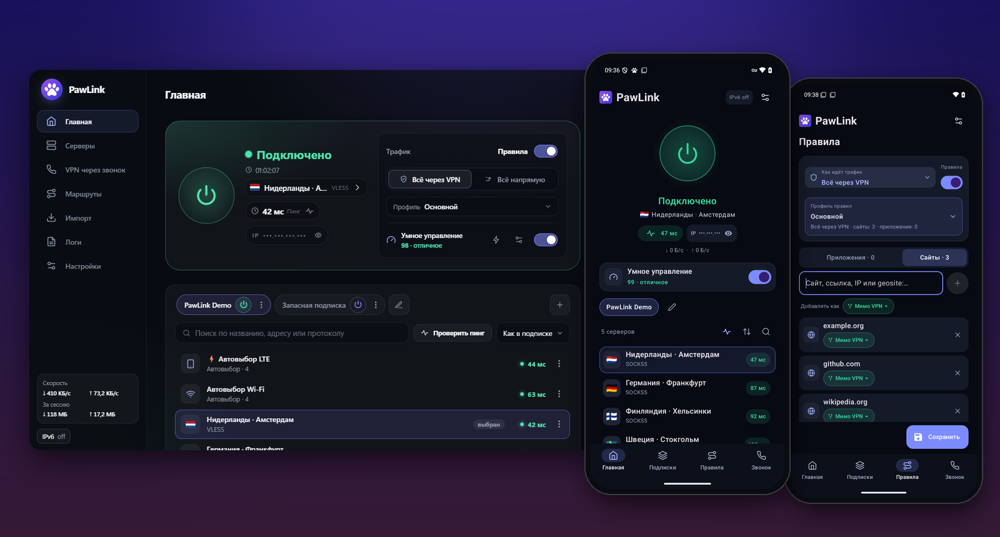
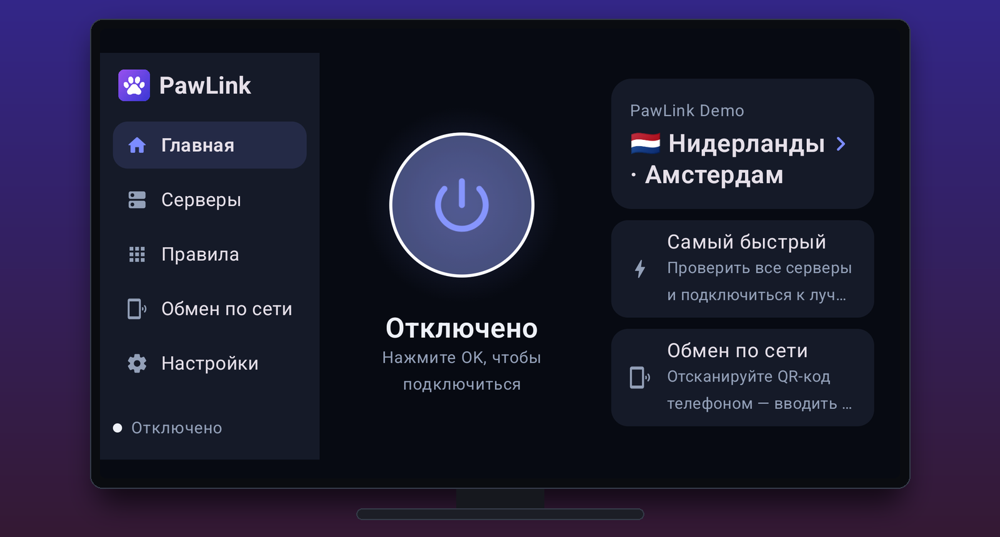

  <strong>Русский</strong> · <a href="README.en.md">English</a>

  

<h1 align="center">PawLink</h1>

  <strong>VPN-клиент для Windows, Android и Android TV</strong> 
  Добавьте подписку или ключ и подключитесь в одно нажатие.

  
  
   
  Один APK для Android и Android TV · <a href="../../releases">Все релизы</a>

  
   
  Интерфейс PawLink 3.0.0 · демонстрационные данные

## Быстрый старт

1. Скачайте и установите PawLink.
2. Добавьте ссылку или ключ от вашего VPN-провайдера. В Windows откройте «Импорт», на Android нажмите «+» в разделе «Подписки». На телефоне также можно отсканировать QR-код или отправить ссылку через меню «Поделиться».
3. Выберите сервер и нажмите кнопку подключения.

PawLink бесплатен. Подписку или ключ предоставляет ваш VPN-провайдер. Также можно использовать собственный сервер.

## Возможности

- **Автоподбор и переподключение.** PawLink проверяет доступность серверов и может переключиться на другой узел при сбое.
- **Раздельная маршрутизация.** Выберите, какие сайты и приложения идут через VPN, а какие подключаются напрямую. Правила можно сохранять в отдельные профили.
- **VPN через звонок.** Режим на базе WDTT-Plus для сетей с ограничениями. Можно импортировать готовую ссылку или настроить свой VPS. Доступность зависит от сети.
- **Блокировка рекламы.** Включается в настройках одним переключателем.

## Android TV

Установите тот же APK и включите ТВ-режим. Крупные элементы рассчитаны на пульт. Чтобы перенести серверы, откройте «Обмен по сети» на телевизоре. На телефоне выберите «Обмен по сети» → «Отправить», затем отсканируйте QR-код с телевизора или введите восьмизначный код.

  

## Частые вопросы

<strong>Какие форматы поддерживаются?</strong>

Ссылки на подписки, отдельные ключи, QR-коды и файлы Clash или WireGuard. Среди поддерживаемых протоколов — VLESS (включая REALITY), VMess, Trojan, Shadowsocks, Hysteria2, TUIC, WireGuard, AmneziaWG, SOCKS и HTTP.

<strong>Как установить приложение, если система показывает предупреждение?</strong>

В Windows SmartScreen откройте «Подробнее» → «Выполнить в любом случае». Для режима TUN нужны права администратора. На Android разрешите установку из источника, которым открыли APK.

<strong>Что проверить, если VPN отключается в фоне на Android?</strong>

Проверьте ограничения батареи для PawLink и настройки «Постоянный VPN» у других VPN-приложений.

<strong>Как исключить приложение из VPN?</strong>

Откройте «Правила» и выберите режим маршрутизации по приложениям. Даже при прямом маршруте отдельные приложения Android могут определять, что системный VPN активен.

<strong>Что нужно для своего сервера «VPN через звонок»?</strong>

VPS с Ubuntu 22.04 или 24.04, от 1 ядра и 512 МБ памяти, с доступом по SSH. PawLink может установить компоненты и создать ссылки для подключения.

## Обратная связь

Сообщите об ошибке или предложите улучшение в [Issues](https://github.com/FelixEnotix/PawLink/issues). Для ошибки укажите платформу, версию PawLink и шаги воспроизведения.

---

«VPN через звонок» основан на <a href="https://github.com/Ivan4537/WDTT-Plus">WDTT-Plus</a> (GPLv3). Флаги в Windows — Twemoji Country Flags (CC BY 4.0). <a href="LICENSE">Лицензии</a>.
